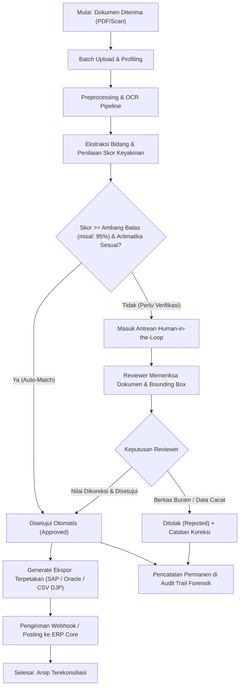
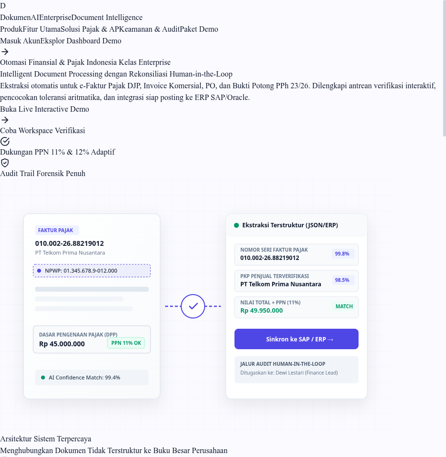
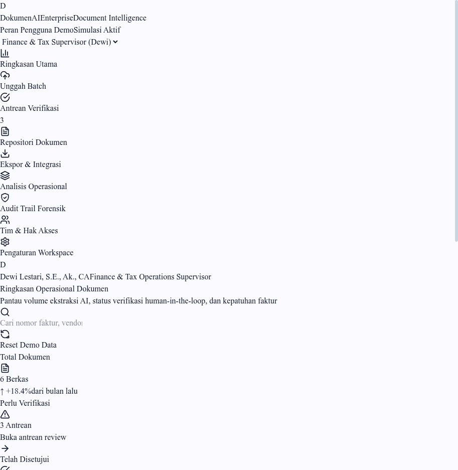
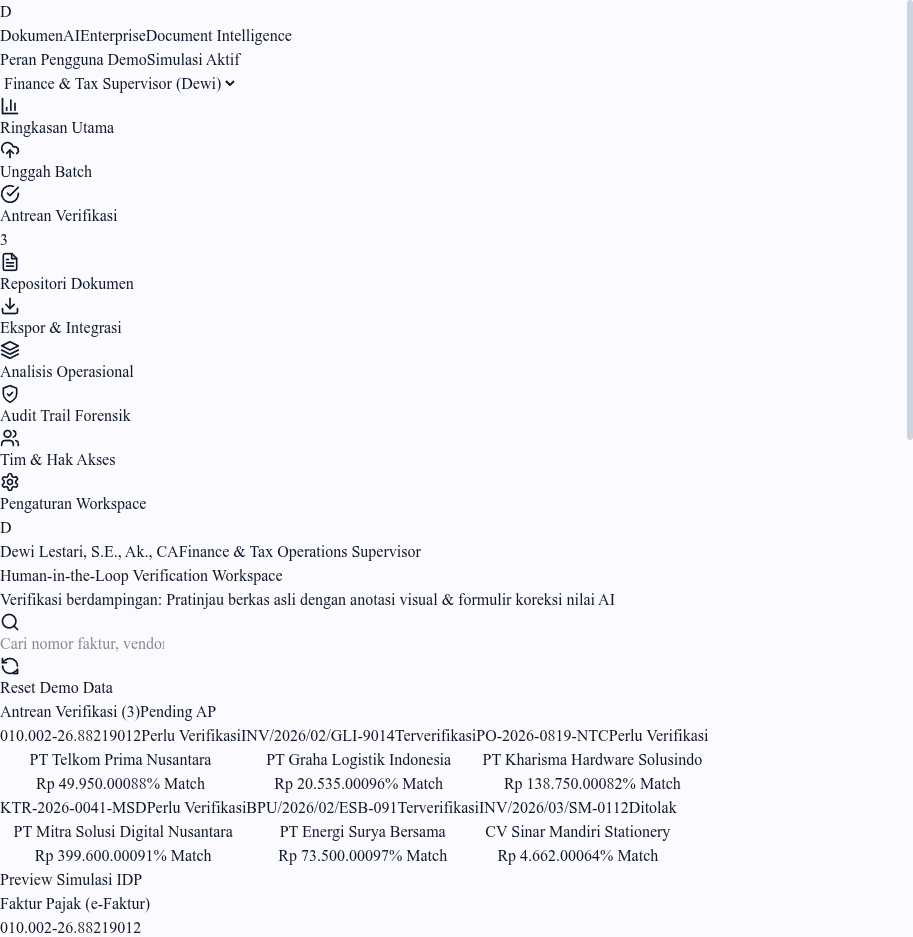
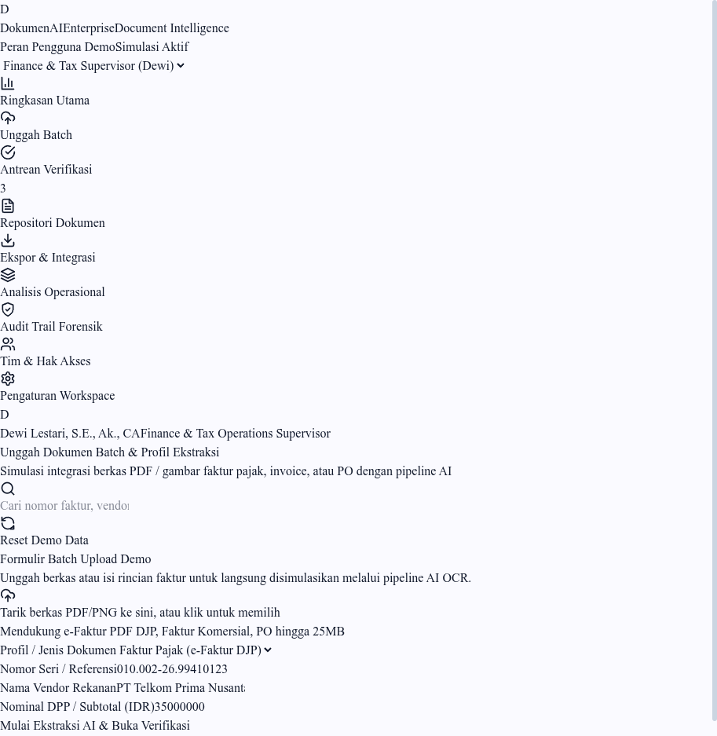
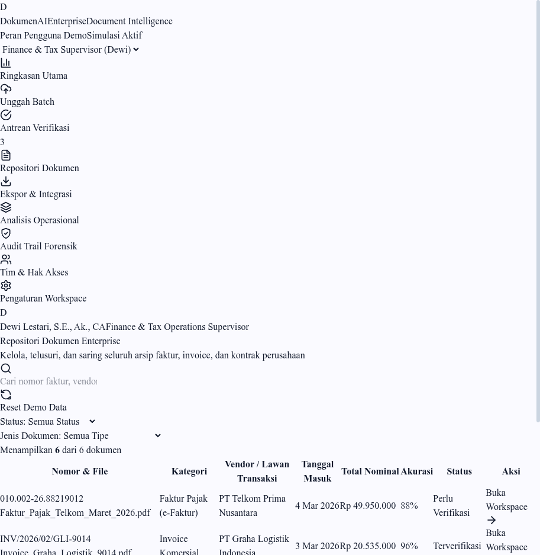
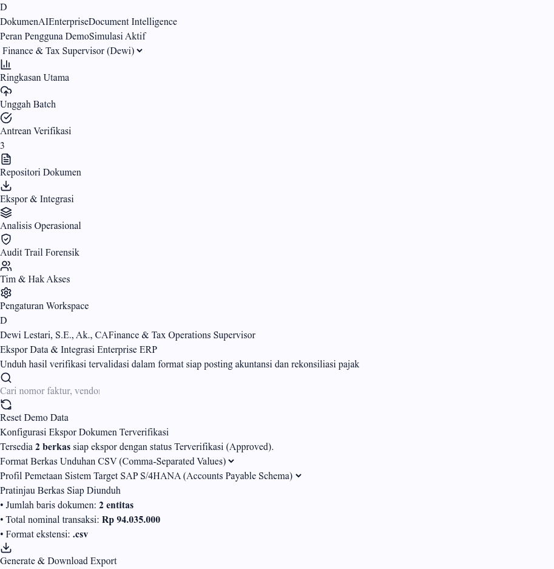

# DokumenAI Enterprise — Platform Intelligent Document Processing (IDP)

[](https://nextjs.org/)
[](https://react.dev/)
[](https://www.typescriptlang.org/)
[](https://tailwindcss.com/)
[](https://bun.sh/)
[](https://vercel.com/)

> **DokumenAI Enterprise** adalah platform B2B SaaS *Intelligent Document Processing* (IDP) kelas enterprise yang dirancang untuk mengotomasi alur kerja ekstraksi, verifikasi rekonsiliasi, dan audit kepatuhan atas dokumen komersial dan perpajakan Indonesia (e-Faktur Pajak DJP, Invoice Komersial AP, Purchase Order, Bukti Potong PPh 23/26, Surat Jalan, dan Kontrak Perjanjian).

---

## 1. Project Overview (Gambaran Umum Proyek)

### Ringkasan Eksekutif
Banyak departemen keuangan (*Accounts Payable* / AP) dan divisi perpajakan di Indonesia yang masih memproses ribuan faktur kertas dan PDF secara manual. Proses pengetikan ulang data satu per satu memakan waktu, rawan salah ketik nominal atau nomor seri faktur pajak (NSFP), serta menyulitkan rekonsiliasi dengan sistem akuntansi / ERP seperti SAP, Oracle, atau Microsoft Dynamics.

**DokumenAI Enterprise** hadir untuk mentransformasi dokumen bisnis tidak terstruktur menjadi data terstruktur siap-posting ke buku besar perusahaan. Melalui kombinasi pipeline OCR modern, kalkulasi aturan validasi aritmatika otomatis, dan antarmuka **Human-in-the-Loop Verification Workspace**, platform ini memastikan setiap data yang masuk ke sistem keuangan memiliki tingkat kepatuhan dan akurasi mendekati 100%.

### Apa itu Intelligent Document Processing (IDP)?
Berbeda dengan pembaca PDF standar (*PDF Reader*) atau penyimpanan arsip digital (*Cloud Storage*) biasa yang hanya menyimpan berkas pasif, IDP bertindak sebagai mesin kognitif cerdas yang:
1. Membaca teks dan memindai tata letak visual lembar berkas.
2. Mengekstrak entitas penting (*Key-Value Pairs* seperti Nomor Dokumen, Nama Vendor, NPWP, Tanggal, DPP, PPN, dan Item Baris).
3. Menilai tingkat keyakinan (*confidence score*) per bidang.
4. Menerapkan aturan bisnis spesifik negara (misalnya: formula PPN Indonesia 11% / 12% dan validasi format 16-digit e-Faktur).
5. Mengarahkan dokumen berisiko ke verifikator manusia sebelum data disinkronkan ke ERP.

---

## 2. Latar Belakang & Masalah Bisnis Nyata (Real Business Problems)

| Masalah Bisnis Nyata | Gejala & Akar Penyebab Operasional | Dampak Finansial & Risiko |
| :--- | :--- | :--- |
| **1. Entri Data Manual Lambat** | Staf AP mengetik ulang rincian nomor faktur, DPP, PPN, dan rincian puluhan item barang per faktur secara manual. | Siklus persetujuan faktur molor 5–10 hari, biaya lembur tinggi, dan hilangnya diskon pembayaran cepat dari vendor. |
| **2. Variasi Format Vendor Tak Terbatas** | Setiap pemasok menggunakan format faktur berbeda (tata letak kolom, istilah tanggal, format desimal). | Template ekstraksi kaku (*rule-based*) sering gagal membaca berkas yang formatnya sedikit bergeser. |
| **3. Selisih Aritmatika & Validasi Pajak** | Terjadi salah ketik pada NPWP, NSFP, atau selisih pembulatan nilai PPN beberapa rupiah. | Risiko koreksi fiskal oleh kantor pajak, sanksi denda ketidaksesuaian faktur masukan, dan rekonsiliasi bank macet. |
| **4. Jejak Audit Lemah & Sulit Dilacak** | Koreksi nilai faktur dilakukan di lembar Excel terpisah tanpa pencatatan siapa yang mengubah nominal. | Temuan audit internal/eksternal (*fraud risk*), sulit membuktikan otoritas staf yang menyetujui pembayaran. |
| **5. Fragmentasi Aplikasi Bisnis** | Data faktur harus disalin bolak-balik antara portal DJP e-Faktur, email vendor, dan sistem ERP core. | Tingginya potensi duplikasi pembayaran faktur (*duplicate invoice payment*) dan data tidak sinkron. |

---

## 3. Pemetaan Masalah ke Solusi (Problem-to-Solution Mapping)

| Masalah Bisnis | Akar Masalah | Solusi DokumenAI Enterprise | Manfaat Terukur yang Diharapkan |
| :--- | :--- | :--- | :--- |
| **Pengetikan manual berulang** | Transfer data antar-sistem manual | Ekstraksi terstruktur AI dengan kalkulasi cepat (<1.5 detik/berkas) | Mengurangi waktu input repetitif hingga 80% |
| **Salah ketik nominal & pajak** | Keterbatasan ketelitian mata manusia | Validasi aturan aritmatika DPP + PPN 11%/12% otomatis | Menghilangkan selisih perhitungan sebelum masuk buku besar |
| **Format dokumen acak** | Layout faktur tiap pemasok unik | Pengenalan profil dokumen & pemetaan koordinat visual (*bounding box*) | Penanganan fleksibel untuk berbagai variasi berkas vendor |
| **Kurang transparansi revisi** | Tidak adanya log histori edit | Rekam Jejak Forensik (Audit Trail) dengan IP, Aktor, & Waktu ISO | Memenuhi standar kepatuhan tata kelola korporasi (SOX/ISO) |
| **Integrasi ERP kompleks** | Struktur tabel antar-aplikasi beda | Profil pemetaan ekspor siap-impor (SAP, Oracle, DJP SPT) | Posting jurnal hutang usaha langsung dalam hitungan menit |

---

## 4. Solusi Komprehensif Platform

DokumenAI Enterprise mengintegrasikan seluruh rantai pemrosesan dokumen:
1. **Batch Upload**: Pengunggahan berkas secara massal (PDF / gambar) dengan pemilihan profil ekstraksi yang fleksibel.
2. **Deterministic Processing Pipeline**: Tahapan simulasi pemrosesan transparan (*Queued* → *Preprocessing* → *OCR* → *Field Extraction* → *Schema Validation*).
3. **Human-in-the-Loop Workspace**: Antarmuka terpadu yang menampilkan lembar dokumen asli dengan sorotan koordinat (*bounding box*) berdampingan dengan formulir editor nilai.
4. **Approval & Exception Workflow**: Reviewer dapat menyetujui (*Approve*) atau menolak (*Reject*) dengan kewajiban mengisi catatan koreksi.
5. **Central Repository**: Repositori arsip tersentralisasi dengan filter status, kategori, dan pencarian global.
6. **ERP & Accounting Export**: Fasilitas unduhan berkas CSV, JSON API, dan XLSX yang telah dipetakan ke skema ERP.
7. **Operational Analytics**: Dasbor efisiensi jam kerja, rasio persetujuan, dan statistik volume pemrosesan.

---

## 5. Business Model Canvas (BMC)

```
┌─────────────────────────────────────────────────────────────────────────────────────────────────────────┐
│                                       BUSINESS MODEL CANVAS (BMC)                                       │
├───────────────────┬───────────────────┬─────────────────────┬─────────────────────┬─────────────────────┤
│ 8. Key Partners   │ 7. Key Activities │ 2. Value            │ 4. Customer         │ 1. Customer         │
│                   │                   │    Propositions     │    Relationships    │    Segments         │
│ • DJP Pajak API   │ • R&D Model OCR & │ • Ekstraksi e-Faktur│ • Dedicated CSM &   │ • Enterprise Fin/AP │
│   Konsultan Pajak │   Field Extractor │   & PPh 23 akurat   │   Support SLA 99.9% │ • Distribusi & FMCG │
│ • Vendor ERP      │ • Integrasi ERP & │ • Antrean Human-in- │ • Onboarding &      │ • Logistik & Armada │
│   (SAP, Oracle)   │   API Connector   │   the-Loop presisi  │   Training berkala  │ • Kantor Konsultan  │
│ • Penyedia Cloud  │ • Audit & Layanan │ • Jejak audit penuh │ • Portal Helpdesk & │   Pajak & Akuntansi │
│   Infrastruktur   │   Kepatuhan ISO   │ • Zero AI-Slop UI   │   Komunitas B2B     │ • Manufaktur Multi- │
│                   ├───────────────────┤                     ├─────────────────────┤   Cabang Indonesia  │
│                   │ 6. Key Resources  │                     │ 3. Channels         │                     │
│                   │                   │                     │                     │                     │
│                   │ • Dataset Dokumen │                     │ • Enterprise Direct │                     │
│                   │   Fiskal Indonesia│                     │   Sales B2B         │                     │
│                   │ • Desain Sistem & │                     │ • Kemitraan Vendor  │                     │
│                   │   Arsitektur SaaS │                     │   Konsultan ERP     │                     │
│                   │ • Tim AI & AP Lead│                     │ • Portal Web SaaS   │                     │
├───────────────────┴───────────────────┴─────────────────────┴─────────────────────┴─────────────────────┤
│ 9. Cost Structure                                           │ 5. Revenue Streams                        │
│ • Biaya Komputasi Cloud, GPU & Serverless Ingestion         │ • Paket Berlangganan Bulanan / Tahunan    │
│ • R&D dan Pelatihan Model OCR Khusus Dokumen Finansial      │ • Kuota Pemrosesan Dokumen Tambahan (API) │
│ • Dukungan Teknis, Implementasi, dan SLA Enterprise         │ • Biaya Adaptor Integrasi Kustom SAP/ERP  │
│ • Audit Keamanan Siber, Pen-test & Kepatuhan Data           │ • Layanan Konsultasi Alur Kerja AP/Tax    │
└─────────────────────────────────────────────────────────────┴───────────────────────────────────────────┘
```

---

## 6. Target Pengguna & Persona Pengguna (User Personas)

### 1. Dewi Lestari, S.E., Ak., CA — Finance & Tax Operations Supervisor
- **Tanggung Jawab**: Memastikan seluruh faktur vendor valid, kepatuhan PPN/PPh 23, dan menyetujui batch pembayaran.
- **Titik Masalah**: Sering lembur saat akhir bulan (*closing*) karena harus mengecek ratusan faktur pajak satu per satu.
- **Fitur Kunci**: Dashboard Ringkasan, Antrean Verifikasi, dan Ekspor Rekonsiliasi SAP.

### 2. Budi Santoso, S.Kom., M.T. — Chief Information & Security Officer (CISO)
- **Tanggung Jawab**: Keamanan data finansial, tata kelola akses pengguna, integrasi REST API & Webhook.
- **Titik Masalah**: Menghindari risiko kebocoran data rahasia dan memastikan pemisahan hak akses (RBAC).
- **Fitur Kunci**: Audit Trail Forensik, Matriks Hak Akses Tim, dan Pengaturan Webhook.

### 3. Rizky Pratama — Senior Document Verification Specialist
- **Tanggung Jawab**: Memeriksa berkas yang masuk, memperbaiki bidang salah baca, dan menolak faktur cacat/buram.
- **Titik Masalah**: Mata lelah memeriksa angka kecil pada nota pindaian berkas buram.
- **Fitur Kunci**: Batch Upload, Bounding Box Highlighted Editor, dan Koreksi Nilai Cepat.

### 4. Siti Rahmawati, S.Ak., CISA — External Compliance & Tax Auditor
- **Tanggung Jawab**: Menguji kepatuhan pembukuan terhadap regulasi perpajakan dan menelusuri riwayat transaksi.
- **Titik Masalah**: Sulit membuktikan riwayat perubahan data pada dokumen yang disengketakan.
- **Fitur Kunci**: Log Forensik Lengkap (Timestamp ISO, User Role, IP Address, Previous vs New Value).

---

## 7. Alur Kerja Sistem (System Workflow)



---

## 8. Tangkapan Layar Aplikasi & Alur Pengguna (Application Screens)

Seluruh tangkapan layar di bawah ini diambil secara otomatis dari aplikasi nyata yang berjalan menggunakan MCP Playwright:

### 1. Halaman Beranda Publik (Marketing Home)
*Menampilkan nilai bisnis, ilustrasi aliran dokumen orisinal tanpa AI-slop, dan tier harga lisensi.*


### 2. Dashboard Operasional Utama
*Pusat kendali metrik real-time: total dokumen, antrean verifikasi, nilai transaksi, dan tombol aksi cepat.*


### 3. Human-in-the-Loop Verification Workspace
*Fitur kunci: Pratinjau berdampingan dengan penyorotan koordinat (bounding box) dan formulir koreksi nilai.*


### 4. Batch Upload & Simulasi Ekstraksi AI
*Fasilitas unggah berkas massal dengan pilihan profil ekstraksi (e-Faktur, PO, Kontrak, Kuitansi).*


### 5. Repositori Dokumen Terpadu
*Pencarian global, filter status verifikasi, dan filter jenis dokumen dengan aksi cepat ke workspace.*


### 6. Ekspor Data & Integrasi ERP
*Konfigurasi unduhan data siap-impor untuk SAP S/4HANA, Oracle Cloud, dan format SPT Pajak DJP.*


---

## 9. Studi Kasus Bisnis Nyata (Fictional Indonesian Case Study)

**Profil Entitas:** *PT Logistik Prima Nusantara*, perusahaan ekspedisi multi-cabang yang menerima lebih dari 2.500 invoice dan faktur pajak setiap bulannya dari ratusan rekanan vendor truk, pergudangan, dan bahan bakar.

### Sebelum Mengadopsi DokumenAI:
- 4 staf akuntan menghabiskan 6 jam setiap hari untuk mengetik ulang lembar nota ke komputer.
- Sering terjadi selisih pencocokan faktur pajak masukan dengan tagihan vendor saat penutupan SPT Masa PPN.
- Vendor sering mengeluh pembayaran tertunda karena dokumen fisik terselip di cabang.

### Setelah Mengadopsi Alur DokumenAI Enterprise:
- Seluruh faktur masuk diunggah secara terpusat oleh admin kantor cabang.
- Dokumen dengan akurasi 98% langsung siap diverifikasi dalam hitungan detik.
- Tim verifikator pusat hanya memfokuskan perhatian pada dokumen bertanda peringatan (*warning badge*).
- Data yang disetujui langsung diekspor ke SAP ERP setiap sore, memangkas siklus pembayaran vendor dari 7 hari menjadi 24 jam.

---

## 10. Panduan Instalasi & Pengembangan Lokal

### Prasyarat:
- [Bun](https://bun.sh/) versi 1.2+ atau [Node.js](https://nodejs.org/) v20+
- Git

### Langkah Instalasi:
```bash
# 1. Clone repository
git clone https://github.com/prohject_technocomputer.git
cd prohject_technocomputer

# 2. Install dependensi menggunakan Bun (Direkomendasikan)
bun install

# 3. Salin environment variable contoh
cp .env.example .env.local

# 4. Jalankan development server
bun run dev
```

Buka peramban di [http://localhost:3000](http://localhost:3000) untuk mengakses portal.

### Menjalankan Kompilasi Produksi (Production Build):
```bash
bun run build
bun run start -p 3005
```

---

## 11. Batasan & Karakteristik Simulasi (Known Limitations)

Demi menjaga transparansi profesional:
- **Simulasi Deterministik**: Mesin ekstraksi AI disimulasikan secara deterministik untuk stabilitas pengujian otomatis offline tanpa ketergantungan API pihak ketiga.
- **Data Fiktif**: Seluruh nama perseroan, nomor NPWP, dan nomor seri faktur pajak adalah data rekaan semata.
- **Penyimpanan Lokal**: Perubahan status verifikasi disimpan di `localStorage` peramban. Tombol "Reset Demo Data" di topbar dapat digunakan kapan saja untuk mengembalikan data awal.

---

## 12. Peta Jalan Pengembangan Mendatang (Future Roadmap)

1. **Integrasi Model AI Neural Nyata**: Penyambungan ke Google Cloud Document AI / LayoutLMv3 untuk ekstraksi multimodal live.
2. **Database PostgreSQL & Prisma ORM**: Migrasi persistensi dari browser local-storage ke database relasional dengan isolasi multi-tenant.
3. **Penyimpanan Objek AWS S3 / Cloudflare R2**: Penyimpanan berkas PDF fisik terenkripsi tingkat militer (AES-256).
4. **SSO OAuth2 & SAML 2.0**: Autentikasi korporat melalui Microsoft Azure AD, Google Workspace, dan Okta.
5. **Konektor Langsung SAP RFC / BAPI**: Integrasi pengiriman otomatis tanpa perlu unduhan berkas manual.

---

## 13. Metrik Evaluasi & Indikator Kinerja Kunci (KPIs)

| Metrik Evaluasi | Definisi & Metode Pengukuran | Target Kinerja B2B |
| :--- | :--- | :--- |
| **Field Extraction Accuracy** | Rasio bidang terisi dengan nilai teks yang benar terhadap dokumen asli. | Target: > 98.5% |
| **Straight-Through Processing (STP)** | Persentase dokumen yang langsung lolos validasi otomatis tanpa perlu sentuhan reviewer. | Target: > 70.0% |
| **Review Turnaround Time** | Waktu yang dibutuhkan verifikator manusia untuk memeriksa dan menyetujui satu dokumen. | Target: < 45 Detik |
| **Duplicate Detection Rate** | Keberhasilan mendeteksi kesamaan nomor faktur/vendor sebelum posting jurnal. | Target: 100% |

---

## 14. Kesimpulan Proyek

**DokumenAI Enterprise** mendemonstrasikan bahwa otomasi cerdas dokumen finansial bukan sekadar membaca teks, melainkan menyatukan desain antarmuka enterprise yang tenang, validasi aturan bisnis yang ketat, dan transparansi alur kerja *human-in-the-loop*. Aplikasi ini dibangun dengan standar kualitas tinggi, lulus uji kompilasi produksi, dan siap diimplementasikan lebih lanjut ke ranah komersial.
